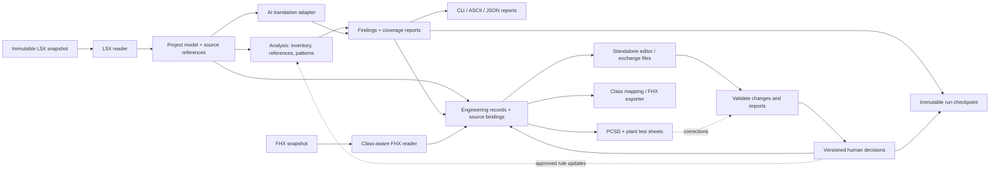

# Architecture — source evidence, analysis, and review

Status: proposed design, updated 2026-10-12. The standalone inspection helpers exist; the application architecture below is not implemented.

## Central design

Use one analysis library with a CLI adapter now and a preferred standalone editor later. Keep source facts, inferred findings, and human-approved decisions separate. The original export is the evidence; a normalized project model makes it convenient to query; review records explain changes in interpretation. L5X analysis feeds both user-readable investigation reports and editable engineering records used to build the PCSD.



The AI adapter is optional and explicitly configured. Parsing and ordinary reporting must work offline. CLI and GUI call the same services and use the same validation rules; neither owns a separate interpretation of the source.

## PCSD discovery before schema design

PCSD means Process Control Strategy Document. In the earlier MOD migration it
used Excel and supported plant test-sheet generation for a DeltaV unit and
simulation. The new PCSD content must follow what can be extracted and reviewed
from L5X. These are discovery categories, not a finalized database schema:

| Category | Information to investigate |
|---|---|
| I/O and communications | AI/AO/DI/DO, configured ranges/units where present, aliases, field connections, external references and communication inputs/outputs |
| PID and selectors | PV/SP/output sources, selector conditions, master/slave relationships, control type/modes and flowchart connections |
| Equipment | Valves, pumps and other device roles, commands, feedback, permissives and interlocks, with supporting source logic |
| Alarms | Trigger/reset/delay behavior, warning or shutdown effects, affected objects and ranking evidence; missing external alarm definitions stay unresolved |
| Calculations | Standalone Boolean and floating-point expressions, operands, results and dependencies relevant to DeltaV misc/bool logic |
| Sequences | Source states, transitions and actions, plus proposed steps when the L5X does not already expose the desired target sequence |
| Target organization | Reviewed assignment to classes, modules, units and execution locations, kept distinct from source program/routine grouping |
| Test sheets | Reviewed preconditions, actions and expected outcomes linked to strategy objects; later observed test results remain separate from expectations |

Do not infer a complete strategy from similar rung shapes. Preserve the evidence
for extracted behavior and mark engineering-authored target strategy separately.
Moving an object in the editor changes its organization, not its source locator.
Detailed sequence design and the final PCSD layout remain open.

## Editor and storage direction

Tyler prefers a standalone editor with object search, source drill-down, change
comparison, grouping/reassignment, import/export and backup/restore. Users should
not need Python, SQL or programming knowledge. Excel remains a possible review,
exchange and test-sheet format. Select the GUI toolkit after a small real workflow
and its data contracts are demonstrated.

Proposal: evaluate a local SQLite project store with versioned records, explicit
change history and portable JSON/Excel exchanges. This revises the earlier idea
that SQLite could only be a later search index; the canonical storage choice is
not finalized. If selected, SQLite is the authoritative editor store and exports
are versioned snapshots, not a second independently writable database. A local
store plus validated handoff packages supports the preferred initial sequential
review workflow: one active editor at a time. Each handoff identifies its base
revision; returned changes must match the expected base before application.
Stale copies are flagged for reconciliation. Concurrent editing or a shared live
server would be a later explicit requirement.

Sequential means one active editor, not a fixed order of people or teams. Keep
reviewer identity, current assignment, handoff recipient and revision history
as data. Enforce the initial editing policy through the review service; do not
encode organization names or a fixed recipient chain in the parser, schema or
UI. This leaves room for later routing policies without building a general
workflow engine in Phase 1.

SQLite documents desktop application storage as an intended use and supplies a
[backup API](https://www.sqlite.org/backup.html); its core is
[public domain](https://www.sqlite.org/copyright.html). Review the
[deployment/concurrency guidance](https://www.sqlite.org/whentouse.html) when
choosing local storage versus a service. A database does not itself supply the
project's review history or correction semantics; the application must do that.

For Windows distribution, [PyInstaller](https://www.pyinstaller.org/en/stable/operating-mode.html)
is one candidate that bundles Python and dependencies so users need no separate
Python installation. Packaging is not implemented. Validate the eventual build
on a target Windows machine without a development environment, including imports,
reports, backup/restore and readable error messages.

## Repository and local-data layout

Keep the existing Python project location initially. The hyphenated directory name is a filesystem directory; the importable package uses underscores.

```text
repository/
  README.md
  CODEX_HANDOFF.md                  pointer to public/CODEX_HANDOFF.md
  .gitignore
  public/
    CODEX_HANDOFF.md                 canonical portable handoff
    docs/planning/
    examples/                       independently synthetic JSON examples
    fixtures/synthetic/             canonical L5X + expected results
    tools/                          generic helper scripts
    schemas/                        add with persisted models
  python-parser/
    pyproject.toml
    uv.lock
    main.py                         compatibility entry point only
    src/plc_workbench/
      __init__.py
      __main__.py                   python -m plc_workbench
      cli.py                        argparse, dispatch, exit codes
      services.py                   coordinate reader, analysis, storage
      models.py                     initial typed records and source references
      readers/
        l5x_reader.py                XML adapter and coverage accounting
        l5x_tags.py                  optional l5x package adapter
      analysis/
        inventory.py
        references.py
        classification.py
        patterns.py
      ladder/
        tokens.py
        parser.py
        nodes.py
        ascii.py
      review/
        decisions.py
        workbook.py
      translation/
        glossary.py
        provider.py
      storage/
        runs.py
        migrations.py
      reporting/
        json_report.py
        text_report.py
      sharing/
        synthetic.py
        redaction.py
    tests/
      unit/
      integration/
      # Read canonical fixtures/expected results from public/fixtures/synthetic.
      # Add small test-only synthetic edge cases when needed.
  confidential/                     ignored, all actual plant data
    plc-code/                       user-maintained inputs
    <existing target backup>/       preserve current input-folder name
    workspaces/<case_id>/
      workspace.json                schema, settings, selected source set
      sources/<snapshot_id>/        immutable copy + source manifest
      decisions/<branch_id>/        immutable decision batches
      glossary/                     private approved terminology
      reviews/
        outbox/
        inbox/
        archive/
      artifacts/<run_id>/
        manifest.json
        inventory.json
        entities.jsonl
        relationships.jsonl
        findings.jsonl
        coverage.json
        coverage_details.jsonl
        ignored.jsonl
        errors.jsonl
        logs/events.jsonl
        reports/
        deliverables/
        test_results/
      share_candidates/             still confidential until reviewed
```

This is an earlier proposed destination map, not a request to implement every file now. Its JSON/run-directory layout must be reconciled with the editor storage decision before implementation; immutable source evidence and versioned exports remain requirements. Begin with cli, services, models, one reader and inventory. Split models into a package only when the records become large enough to warrant it.

`artifacts/` is a chosen convention for generated results, not a Python-mandated name. Unit tests are code under `tests/`; generated test results belong under `confidential/`.

## Dependency direction and contracts

- `cli.py` parses arguments and handles terminal output; it never traverses raw XML.
- `services.py` coordinates a use case such as importing a snapshot or analyzing a routine.
- Readers convert source-specific structures into typed records with source references.
- Analysis consumes these records and produces results without printing or doing file/network I/O.
- Storage persists source snapshots, results, and review decisions through a small interface.
- Presenters render results as text, ASCII, JSON, workbook rows, and eventually GUI views.
- Translation providers sit behind an adapter. They produce suggestions, never authoritative edits.
- Target exporters are later adapters consuming reviewed mappings. They do not become part of the L5X reader.

Example service contracts, to finalize before implementation:

```python
ingest_l5x(path, options) -> IngestResult
build_inventory(snapshot) -> InventoryResult
parse_rung(rung_text, source_ref) -> RungParseResult
render_ascii(rung_ast, options) -> RenderResult
find_references(snapshot, scope, operand) -> ReferenceResult
classify(snapshot, rules, decisions) -> FindingsResult
import_review(workbook, base_run, decisions) -> ReviewImportResult
```

Results include diagnostic records. A GUI can subscribe to progress callbacks supplied by services and request cancellation between work units. Do not add async infrastructure until a concrete operation needs it; long jobs can run in a worker later.

## Initial tooling proposal

- Python 3.12+ and uv, preserving the current project environment.
- Built-in argparse subcommands and help. argparse and pathlib should not be third-party dependencies.
- A safe XML parser adapter, such as defusedxml's ElementTree-compatible interface, with an explicit DTD/entity rejection policy and resource limits.
- Pydantic 2 for validated persisted records and generated JSON Schemas. Use strict persisted-field validation; do not silently convert blank reviewer cells into zero/false.
- Existing `l5x` package behind a tag adapter where its behavior is useful. Do not let its incomplete coverage define the project model.
- pytest and Ruff for development. Add property-based testing when the grammar is ready.
- openpyxl when workbook round trips are implemented. No Excel automation is required.
- Evaluate SQLite for editor storage as described above. Add Rich, NetworkX and a GUI toolkit only when the selected workflow justifies them.

Verify dependencies against synthetic exports and the actual supported Logix versions. The `l5x` package documents tag/program/module access and language limitations; it is not the complete analysis engine.

## Source model and discovery

Model these separately:
- Export metadata: software/schema revisions, full versus partial context, language settings.
- Controller identity and source snapshot.
- Tasks: type, configured period, priority, watchdog, schedule order, safety-related attributes where exported.
- Programs and their routine definitions, main/fault routine references, scheduling relationships, and unscheduled status.
- Routines: language, source order, attributes, opaque/encoded state, plus language-specific content.
- Rungs: source ordinal, displayed number, rung type, comments/languages, exact neutral text.
- Tag declarations by scope, aliases, datatype definitions/members, arrays, values, and descriptions.
- AOI definitions, parameters, local tags, routines, and separate call instances.
- I/O modules, ports, connection metadata, and external communications.
- SFC steps/transitions/actions/links when structurally identifiable, even before semantic analysis.
- Unknown XML elements and attributes, preserving their source location and raw recoverability.

Tasks schedule programs; routines belong to programs. Keep both relationships rather than forcing every record into a single tree. AOI definition logic is distinct from each call's execution context.

Count declarations, references, array elements, and structure members separately. A timer's members are not independent tag declarations. RLL, SFC, ST, and FBD routine counts must not depend on finding ladder rungs. Unknown or unimplemented statistics are null with an explanation, not zero.

JMP counts must come from parsed instruction tokens, not a search across comments and names. An initial inventory can count tokens without having a complete semantic engine, but must report tokenization failures and count coverage.

Preserve the exact original file bytes. XML reserialization alone cannot preserve every original byte or CDATA representation. A source locator is initially a structural path and ordinal; do not promise exact line/column or byte spans until the parser actually records them.

## Ladder structure and ASCII rendering

Parse neutral text into an ordered syntax tree:
- Series: an ordered sequence.
- Parallel: an ordered list of branch paths.
- Instruction: mnemonic, ordered operands, raw spelling, source token span.
- Explicit empty path, if present.
- Opaque/unsupported node and diagnostic, with original text retained.

This is an AST (abstract syntax tree): a structured representation of the rung syntax, not a simulation.

The tokenizer must distinguish branch commas from instruction arguments, brackets in array subscripts, nested expressions, quoted strings and escapes, and labels/special tokens. Investigate each syntax using documentation and synthetic samples rather than broad regex assumptions.

The ASCII renderer operates on this tree. It must not reread XML or infer plant meaning. It supports labels, instruction IDs, placeholders, width limits, and raw-text fallback. Each displayed instruction can resolve back to its source node. Report partial rendering when an opaque region is present.

## Relationships and scan context

Build distinct edge types instead of one undifferentiated graph:
- contains, schedules, calls, jumps_to;
- reads, writes, read_writes, aliases;
- produces, consumes, messages_to;
- uses_datatype, calls_aoi;
- derived_from, reviewed_as, mapped_to.

An instruction catalog identifies operand roles by instruction and supported revision. Unknown instructions have unknown operand effects. Do not classify every operand as a read or guess output behavior from a mnemonic.

Resolve scope before name: duplicate local names in different programs remain separate. Keep indirect addresses, dynamic array indices, alias cycles, unresolved references, external symbols, and missing partial-export context explicit.

JMP/LBL connections are within a routine; JSR connects routines. Preserve conditional jumps, loops, conditional calls, MCR zones, output instructions, stateful timers/counters, latches, and shared mutable data. Do not use Boolean simplification to establish execution equivalence.

Timing has several dimensions: task schedule/priority, I/O update configuration, communication timing, and actual runtime behavior. A static export supplies configured values, not proof of effective scan rate. Cross-controller graphs need separate source snapshots and confirmed endpoint bindings; unresolved peers stay external.

## Classifications and pattern drill-down

Allow multiple classifications per object, and classifications at instruction, branch, rung, routine, tag, or connected-region scope. A rung may simultaneously contain an alarm condition, a permissive, and a timer.

Store rule/model version, evidence source IDs, rationale, uncertainty, and review status. A name suggesting ALARM is weaker evidence than a recognized instruction or approved engineering mapping. Unknown/custom AOIs and safety-relevant areas require explicit review.

Keep three pattern families distinct:
1. Structural: instruction order and branch shape; identifiers replaced with role placeholders while repeated-operand identity remains.
2. Typed: additionally preserves datatype and instruction-operand roles.
3. Contextual: additionally records selected values, timer modes/presets, call/scheduling context, and relevant boundaries.

Preserve order; do not sort branches or reorder instructions to get more matches. Structural similarity is a candidate grouping, not a conversion recommendation.

A pattern record describes the generic shape. Occurrence records bind placeholders to local entity IDs and exact source nodes. Counts are derived from occurrence lists with a documented unit (whole rung or subgraph) and overlap policy. Cross-rung motifs come after reference/control-flow analysis and need boundary inputs/outputs, task context, and unresolved edges.

The GUI navigation can be:
`case -> source -> task/program -> routine -> rung -> branch -> instruction -> operand`.
A second view can be:
`classification -> pattern -> occurrences -> source nodes`.
These are views over shared IDs, not duplicated objects. Repeated objects can appear in multiple views with cross-links.

## Future conversion boundary

Do not translate raw ladder directly to FHX strings. A later phase needs:
- approved equipment/behavior mappings;
- target DeltaV version and library contracts;
- explicit handling of initialization, task periods, scan order, I/O semantics, retentive state, communications, and safety;
- named unsupported constructs;
- engineering validation and target-system tests;
- many-to-many source/target trace links and documented information loss.

Traceability supports back-reference and reconstruction of decisions. It does not promise that an arbitrary target implementation can be automatically inverted into equivalent original ladder code.

## Sources checked

- [Rockwell L5X import/export reference](https://literature.rockwellautomation.com/idc/groups/literature/documents/rm/1756-rm014_-en-p.pdf): XML components and language-specific structures.
- [Rockwell task/program/routine manual](https://literature.rockwellautomation.com/idc/groups/literature/documents/pm/1756-pm005_-en-p.pdf): execution organization.
- [Rockwell general instructions](https://literature.rockwellautomation.com/idc/groups/literature/documents/rm/1756-rm003_-en-p.pdf): instruction behavior including program control.
- [Python Packaging User Guide](https://packaging.python.org/en/latest/discussions/src-layout-vs-flat-layout/): src layout.
- [l5x package documentation](https://pypi.org/project/l5x/): documented adapter capabilities.
- [Pydantic models](https://pydantic.dev/docs/validation/latest/concepts/models/): validation and serialization features.
- [defusedxml](https://github.com/tiran/defusedxml): protected XML parsing.

The module boundaries, checkpoints, and pattern strategy above are engineering proposals for this project, not claims that Rockwell supplies those features.

## Synthetic baseline first

The first fixture is public/fixtures/synthetic/controller_demo.L5X. Keep one canonical copy. Tests should resolve its location from their module path, not from the caller's working directory. The helper under public/tools checks fixture structure and expected counts; it is not the future domain parser. Avoid making application modules import that helper.

Public content is deliberately authored for sharing. Processing real inputs never changes public/ or adds real examples to the tests. A local private baseline can compare independently frozen inputs as the application evolves.
